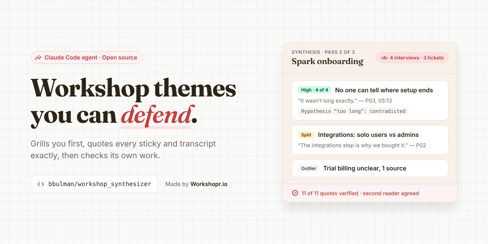

# workshop_synthesizer



A workshop synthesizer for [Claude Code](https://claude.com/claude-code) that grills you first, quotes your sources word for word, and checks its own themes before you see them.

Hand it interviews, survey answers, support tickets, field notes, whiteboard photos or a FigJam board. It asks what decision the research is for, then writes themes where every claim carries a verbatim quote and a source tag. Then it loops: a script checks every quote against the sources, a second agent tries to knock each theme down, and the first agent fixes only what they caught, until the synthesis holds up.

```
/synthesize research/notes/
```

**Site:** [bbulman.github.io/workshop_synthesizer](https://bbulman.github.io/workshop_synthesizer/)

This is the basis for the synthesize harness in [Workshopr.io](https://workshopr.io): the same grill, quote gate and second-reader loop, open-sourced so you can run it in Claude Code on your own research.

## Install

You need Claude Code and Python 3.

```bash
git clone https://github.com/bbulman/workshop_synthesizer.git
cd workshop_synthesizer
./install.sh
```

It copies the two agents to `~/.claude/agents/` and the skill to `~/.claude/skills/synthesize/`, keeping any earlier copy as a backup. Open a new Claude Code session (or type `/reload-skills`), and run `/synthesize` on a folder of notes.

For whiteboard photos nothing else is needed. For FigJam boards, connect a Figma MCP server; the agents fall back to asking for an export or screenshots when none is connected.

## What it does, step by step

1. **Looks before it asks.** It counts your sources by type, notes who the participants are when the notes say so (admin, solo user, new, returning), and flags anything that isn't research, like a PRD in the pile or a FigJam link with no FigJam tool.
2. **Grills you.** One question at a time, each with a recommended answer drawn from what it saw: the decision this informs, the research question (rephrased neutrally if it assumes its answer), who reads the report, which groups to compare, your hunches, what's out of scope. It ends with a five-line brief for you to confirm.
3. **Synthesizes.** A fresh `workshop-synthesizer` agent reads everything before coding anything, codes each source with equal care, clusters the codes into 3–7 themes, and cuts any theme that could have been written without reading the data. Your hunches become hypotheses it marks supported, contradicted or open. They never count as evidence.
4. **Counts instead of guessing.** Each theme lists the sources behind it, as "4 of 4 participants" rather than "most users", with a confidence rating, counter-evidence and, when the notes label groups, a table of themes by group.
5. **Checks every quote.** The agent searches the sources for each quote before it returns, and `check_quotes.py` checks again: case, wording and order must match, and a `[...]` can't stitch two interviews together.
6. **Gets a second opinion.** A fresh `research-verifier` agent re-reads the sources and tries to prove each theme wrong: recounts support, checks the ratings, and looks for smoothed-over contradictions, missed themes and unused sources.
7. **Loops.** If the script or the verifier objects, the synthesizer fixes only what was flagged, and both checks run again. Three passes at most; anything still open is listed plainly.
8. **Reports.** The answer to your question, what happened to each hunch, where the report is saved, and what the checks caught on the way.

## What a theme looks like

```markdown
## Theme 2 — Nobody can tell how far through setup they are
**Observed:** All four participants and one ticket say setup gives no sense of how many steps remain.
**Insight:** The friction is uncertainty about the end, not the length of setup.
**Support:** P01, P02, P03, P04, T03 — 4 of 4 participants, plus 1 ticket
**Confidence:** High — every participant, both segments, no counter-evidence

**Evidence:**
> "It wasn't long exactly. It was more that I couldn't tell where the end was." — P03, 05:13
> "Not the length. A few people said they didn't know when it would end." — P04, 08:16
> "How many more steps are in setup? I have done five screens already." — T03

**Counter-evidence:** none observed
**Implication:** Show progress ("step 3 of 5") before cutting steps.
```

Anything one source says on its own goes under **Outliers**, and what the data can't answer goes under **Gaps**, each with a suggested follow-up.

## Why it holds up

Language models are fluent synthesizers and unreliable ones. They invent or smooth quotes, over-report rare themes, give the first and last sources more weight than the middle, and drift toward whatever the research question seems to want. Four things push back:

- **Quotes are checked by a script, not by trust.** Self-correction without outside feedback makes models worse ([Huang et al. 2023](https://arxiv.org/abs/2310.01798)), so the loop runs on a deterministic quote gate with 12 self-test cases, plus the sources themselves.
- **Counts are computed, not estimated.** In a [World Bank study](https://arxiv.org/abs/2309.17147), ChatGPT coded rare themes about three times as often as experts did, and its errors tracked who the interviewees were. Here every theme carries its source list and an "n of N", and a segment table makes a skew by group visible.
- **Every source has to show up.** Models attend least to the middle of long input ([Liu et al. 2023](https://arxiv.org/abs/2307.03172)). The synthesizer codes one source at a time, and any source that supports no theme is re-read and either coded or named as an outlier.
- **A second reader, with fresh eyes.** Model judges favour their own output ([Zheng et al. 2023](https://arxiv.org/abs/2306.05685)). The verifier never sees the synthesizer's reasoning, only its report and the sources, and has to uphold each theme before the loop stops.

## Use

| You type | What happens |
| --- | --- |
| `/synthesize <folder or files>` | Look, grill, synthesize, check-and-fix loop, report |
| `/synthesize <sources> --quick` | Two questions: the decision, and the research question |
| `/synthesize <sources> --no-grill` | No questions; every assumption is written into the brief |
| `/synthesize <sources> --batch` | The grill asks every open question at once |
| `/synthesize` + attached photos or a FigJam URL | Transcribes stickies verbatim first; illegible ones are flagged, never guessed |
| "Use the workshop-synthesizer agent on these notes" | The agent alone, without the grill or the loop |

In folder mode the report is saved to `research/insights/YYYY-MM-DD-<slug>.md`, with a code sheet beside it on larger studies. Inline, photo and FigJam runs return the report in chat and offer to save it.

## Your sources

The synthesis is only as good as what goes in:

- **Keep timestamps or line numbers** in transcripts. Every quote is tagged with a location, and the verifier checks it there.
- **Put participant attributes at the top of each file** ("Role: workspace admin, Team plan"). The segment view only uses groups the notes state; it never guesses who someone is.
- **One source per file.** It makes the source legend and the coverage check exact.
- **Photograph walls straight on, in good light.** Stickies it can't read are listed as unreadable, not interpreted.

## Try it on the example

[`example/`](example/) holds a made-up onboarding study with planted traps: a split between solo users and admins, a hunch the data contradicts, a single-source issue that shouldn't become a finding, and quotes that invite paraphrase.

```bash
cd example
```

Then, in Claude Code, `/synthesize notes/`. The [example README](example/README.md) lists what's planted and what a good run finds. To see the quote gate on its own:

```bash
python3 ../skills/synthesize/scripts/check_quotes.py bad-report.md notes/
```

## Files

| File | What it is |
| --- | --- |
| [`agents/workshop-synthesizer.md`](agents/workshop-synthesizer.md) | The synthesizer. Modes: text, photo, FigJam, mixed; revision passes |
| [`agents/research-verifier.md`](agents/research-verifier.md) | The second reader. Read-only; returns BLOCKING and MINOR issues |
| [`skills/synthesize/SKILL.md`](skills/synthesize/SKILL.md) | `/synthesize`: look, grill, the loop, the report |
| [`skills/synthesize/scripts/check_quotes.py`](skills/synthesize/scripts/check_quotes.py) | The quote gate. `python3 check_quotes.py --selftest` runs its 12 cases |
| [`install.sh`](install.sh) | Copies the agents and the skill into `~/.claude` |
| [`example/`](example/) | The planted-traps study and a deliberately broken report |
| [`docs/`](docs/) | The GitHub Pages site |

## The research behind it

| Design choice | Source |
| --- | --- |
| The grill runs in the main session, not the agent | Claude Code subagents can't ask the person questions ([docs](https://code.claude.com/docs/en/sub-agents)) |
| One question at a time, each with a recommendation | Matt Pocock's [grilling skill](https://github.com/mattpocock/skills) |
| Hunches are tested, never counted as evidence | Confirmation bias in qualitative analysis; [Braun and Clarke on thematic analysis](https://doi.org/10.1191/1478088706qp063oa) |
| The loop runs on outside checks, capped at three passes | [Building effective agents](https://www.anthropic.com/engineering/building-effective-agents); [Self-Refine](https://arxiv.org/abs/2303.17651); [Huang et al.](https://arxiv.org/abs/2310.01798) |
| Counts per theme, and a segment table | [Ashwin et al., LLMs for qualitative analysis can introduce serious bias](https://arxiv.org/abs/2309.17147) |
| Code one source at a time; check coverage | [Liu et al., Lost in the Middle](https://arxiv.org/abs/2307.03172) |
| A fresh verifier, blind to the synthesizer's reasoning | [Zheng et al.](https://arxiv.org/abs/2306.05685) |
| Cut themes that could exist without the data | The "echo chamber" and hallucination limits in this [mapping study of LLM qualitative analysis](https://arxiv.org/abs/2411.14473) |
| Observation kept apart from interpretation | [Braun and Clarke](https://doi.org/10.1191/1478088706qp063oa); standard affinity-mapping practice |

## Limits

- It hasn't yet been run end to end on a real study; the example is the first test to try.
- The quote gate checks text files only. Quotes from photos and FigJam boards are checked by the agents against their own transcription, which a person should spot-check.
- Handwriting recognition varies with photo quality. Unreadable stickies are flagged, but a misread one can still slip through.
- A full loop costs up to six Opus agent runs: three syntheses and three verifications.
- The second FigJam tool in the agents' tool lists carries a server ID unique to one machine. If your Figma MCP server has a different name, edit the `tools:` line in both agent files.
- It synthesizes; it doesn't replace a researcher's judgment on what matters. Treat the report as a well-sourced first draft.

## License

MIT. Made by [Workshopr.io](https://workshopr.io), where it's the basis for the synthesize harness.
